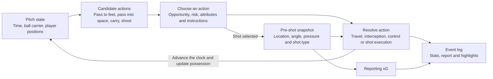

# FM26 match simulation reference for Ballerz

This investigation used REA and targeted read-only inspection of the installed Steam build. The findings cover shipped model resources, native references and the playback interface.

## Installed-build findings

### Tactical roles and instructions in FM26

FM26 lets a manager choose two shapes and give the same footballer a different job in each. A forward can link play in possession and stay high as an outlet after losing the ball. A second forward can threaten the last line in possession and track a midfielder without it. This lets a pair of strikers behave differently even when the team sheet shows both as centre forwards. Sports Interactive describes how positional familiarity and attributes affect suitability, and how the visualiser shows movement as the ball crosses different pitch zones. [FM26 tactics and match AI](https://www.footballmanager.com/fm26/features/possession-out-possession-fm26s-new-tactical-evolution) · [Two-striker example](https://www.footballmanager.com/the-dugout/dominate-dual-strikers-fm26)

#### Breadth in the installed PC build

| Layer | Contents of the shipped tactical registry |
|---|---|
| Team structure | 65 formation-option records, seven mentality options, and 12 style entries with IDs from −1 to 10. The style enumeration includes possession, pressing, wing play, two counterattacking approaches, direct play, deep defence and a blank slate. |
| In-possession roles | 40 distinct role records. Families include distributing goalkeepers, overlapping or ball-playing centre-backs, inside or advancing wing-backs, holding and creative midfielders, wide and inside attackers, and specialist strikers. |
| Out-of-possession roles | 39 distinct role records. Choices include line-holding and sweeping keepers, cover and stopper centre-backs, holding or pressing wide defenders, dropping or screening midfielders, tracking wingers and forwards, and central or splitting counterattack outlets. |
| Team instructions in possession | 19 records with 71 option entries. They cover width, tempo, passing length, reception into feet or space, build-up against pressure, route of progression, supporting runs, dribbling, attacking transition, chance selection, delivery type, keeper distribution and game management. |
| Team instructions out of possession | Nine records with 30 option entries. The controls distinguish the back line's height and behaviour from the line of engagement, when and where to press, responses to losing possession, tackling, defending crosses and closing short goalkeeper distribution. |
| Individual instructions | 15 groups with 45 option entries. Groups cover width, dribbling direction and frequency, forward runs, freedom of movement, holding up play, shooting, passing strategy and risk, crossing strategy and origin, pressing, marking, tackling and marking target. |

The counts come from parsing serialized Unity objects in `ui-staticdataentries_assets_all.bundle` with UnityPy 1.25.4. All 40 attacking-role references, 39 defensive-role references and 28 team-instruction references resolve to distinct objects within their respective lists. The counts include defaults and some related controls. A particular slot, phase or edition of the interface may expose fewer options. Internal names can survive a redesign. For example, the `Trequartista` asset points to the Free Role demonstration, while SI explicitly describes dropping the old role name.

#### What a manager can see

The role records identify a movement demonstration, labels and relevant player instructions. In the shipped `ui-tacticalanimations_assets_all.bundle`, the highlighted player has a separately animated layer. These examples use that player's keyframes on the 296 × 456 preview pitch. The defending and opposing keepers establish the attacking direction in each clip.

| Comparison | What the authored movement shows | Football interpretation |
|---|---|---|
| Inside versus regular wing-back | The inside wing-back moves from x = 272 towards the centre at x = 156 by frame 90. The regular wing-back stays between x = 268 and 274 at the sampled keyframes while gaining ground. | A wide defender can become a midfield passing option or give the team touchline width. |
| False Nine versus Poacher | The False Nine first drops 34 pixels towards their own goal and then attacks again. The poacher finishes 132 pixels closer to the opponents' goal than where they started. | A dropping forward supports combinations while a poacher prioritises runs against the last line. |
| Tracking forward versus splitting outlet | Across their clips the tracker drops 87 pixels. The splitting outlet moves wider and finishes 37 pixels deeper than its start. Its role labels identify staying up and counterattacking. | A manager can trade a deeper defensive presence for an earlier passing outlet after a regain. |
| Pressing defensive midfielder | The player moves 71 pixels towards the opposing goal in the pressing clip. SI's example also describes a settled screening position before joining a high press. | Pressing should depend on field position and the team press. A pressing midfielder still has a position to defend. |

These are illustrative movements from distinct authored scenarios. The distances provide a check on the direction and timing represented by the role. FM26's live action-selection coefficients, role-specific probabilities and movement distances remain unknown. Ballerz can test its own rules against recognisable football decisions, such as whether an inside wing-back actually offers a central pass while the opposite full-back keeps the pitch wide. [Sports Interactive's rest-attack examples](https://www.footballmanager.com/the-dugout/mastering-your-rest-attack-fm26)

#### Ballerz role behaviour in full matches

Ballerz offers 32 in-possession roles and 19 out-of-possession roles across ten positional families. Fourteen shapes can be paired, with one defensive slot per shirt. Eleven playing styles set team instructions independently of the individual roles. The team-sheet movement preview and the live fixture use the same positioning rules.

For a paired check, Northbank played Eastport in a balanced 4-4-2. Each variant uses the same 20 seeds. After each open-play action with Northbank in possession at least 65 metres upfield, the benchmark sampled the selected starter's position while still active. Each match contributes equal weight. Width is the lateral distance from the centre of the pitch, and depth is the distance from Northbank’s own goal line.

| One instruction changed | Width | Depth |
|---|---:|---:|
| Left-back as wing-back | 27.5 m | 53.7 m |
| Same player as inside wing-back | 8.0 m | 48.6 m |
| Striker as poacher | 9.7 m | 79.5 m |
| Same player as false nine | 8.7 m | 69.1 m |

Run `node matchday/scripts/benchmark-roles.mjs 20 20261201` from the repository root to reproduce the comparison. These are Ballerz measurements for two specific lineups.

#### Evidence ledger

| Source | Verified fact |
|---|---|
| REA `ev_21a64ef433e3c7d47c5c250e92b9c2ca3a4e8dc6259d846bb10fa1ef37d51c72` | Role entries expose separate phase IDs, player instructions, movement information and their demonstration. |
| REA `ev_ad05a554c646733831fa421689a75967d3447a74f45064f06d029131ee69d71e` | Team instructions expose their phase, options and associated extra instruction. |
| REA `ev_4f3cd820980d4ae418c1909c06422528fc14ee05d9154295ddc3b4a583aa1d80`, `ev_3661caf1e4846cd020607b64164dbe329f9d11807c26fb741d95827eb880b887`, `ev_aa82064e96a96c997c503f39cf3e7310b91a1a07bf0647f7d2dc179a2b2e4f68` | The installed metadata declares named style and mentality choices, instruction phases including build-up and low/mid/high defensive blocks, and player instruction groups. |
| Unity serialized registries and demonstration tracks | SHA-256 prefixes are `d74425d8481daf38` for the static entries and `8dc6feacd279635e` for tactical animations. These identify the local resources used for the counts and movement comparisons. |

| Area | Observed evidence | Open question |
|---|---|---|
| Chance quality | `shared/data/simatch.fmf` contains versioned xG model records. Its resource directory names distinct categories for regular shots, headers, volleys, penalties and free kicks, including open-goal and obstructed variants. Model fields include distance, shot angle, player-facing angle, ball height, the visible fraction of goal and the players between the ball and the goal. Fields vary by category. | Which model version a live match selects, and whether the simulation uses any of these values when resolving a shot. |
| Shot outcomes | Native event labels distinguish goals, misses, woodwork, saves and blocks. REA identified a separate playback interface for match events, commentary, ball position and highlight timing. | Which inputs or thresholds yield each outcome and where the event is emitted in the simulation. |
| Pressing | Native type records name a pressing factory and distinct handlers for defenders, midfielders and attackers. | The triggers, attributes, weighting and interaction with fatigue in each handler. |
| Passing | Sports Interactive describes attribute-dependent assessment of pass danger and more varied movement by passers, receivers and interceptors. | How FM26 builds the candidate list, ranks it, weighs individual attributes and resolves a chosen pass. [FM26 tactics and Match AI](https://www.footballmanager.com/fm26/features/possession-out-possession-fm26s-new-tactical-evolution) |

The xG resource directory has a compressed index at file offset `0x143450`. The field-level frame scan found 110 records tagged with a shot type and coefficient data. A native routine at DLL RVA `0x3660c00` references the model-version, coefficient, shot-type and intercept fields. Role-specific pressing type records resolve to distinct virtual tables. These are static observations of data and references.

REA evidence `ev_c5393d93ce37beaea5178bd87c7aa9df1c61cca4697f1926b58aa98a6d55e3a0` covers all 247 export entries of `game_plugin.dll`. The DLL SHA-256 begins `eb6c86fab56e051f`. The `simatch.fmf` SHA-256 begins `ac0a423665f62a2b`.

## Current Ballerz baseline

Each row averages 2,000 seeded test matches. Both starting XIs, both formations and Eastport's balanced plan stayed fixed. The home team changed one instruction at a time. The paired seeds used the existing test generator with seed indices 1 through 2,000 multiplied by 7,919.

| Northbank plan | Attempted passes | Completion | Line-breaking passes | Shots | Goals | xG |
|---|---:|---:|---:|---:|---:|---:|
| Balanced | 39.92 | 76.7% | 1.53 | 16.16 | 1.58 | 1.66 |
| Short build-up | 70.88 | 80.3% | 0.00 | 15.79 | 1.51 | 1.54 |
| Direct build-up | 48.24 | 69.3% | 21.26 | 17.76 | 1.88 | 1.88 |
| High press | 40.01 | 75.2% | 1.11 | 21.67 | 2.21 | 2.27 |

The current engine samples one possession sequence per minute, so its pass totals describe sampled actions. Its three shot zones omit shot angle, blocks and woodwork. Short build-up produced zero completed line-breaking passes across this fixture sample. That is a useful regression case for tactical variety across formations and players.

For an original Ballerz model, a recorded chance can carry shot location, angle, goal visibility, pressure and shot type. Shot execution can resolve contact, interception and goalkeeping from that same context. Fit the reporting xG model independently from observed outcomes and measure calibration by shot category. For passing, use matched simulations that vary one attribute or instruction and measure attempted pass types, completion, turnovers and resulting chance quality. Validate pressing against when and where teams win the ball and how those effects change with condition.

## Follow-up trace

The routine at DLL RVA `0xc93b70` stores an allocated object in a global slot. It calls the xG registry routine at `0x365d240` from call site `0xc93c24` and branches on its return value. Separately, the routine at `0x2506a60` constructs an `XG_SHOT_DATA` object and passes the new object together with a field on its parent object. This identifies two concrete paths to follow. The exact call chain from shot creation to xG evaluation and goal resolution remains open.

The routine at `0x2519b50` allocates and stores three distinct pressing components. Their virtual tables resolve to the defender, midfielder and attacker pressing types. The code establishes that the components coexist on the same object. The thresholds for engaging, covering and releasing remain open.

REA linked `FM.Match.MatchEventList.get_MatchEventData` and `FM.Match.MatchEventData.get_MatchFrame` to native methods in `GameAssembly.dll`. Those accessors and the native playback interface support investigating event consumption separately from simulation. Evidence `ev_c2ef41ba1b4aee4326d5d46f93524b4f8b3ff96a0e888b93513ea71c77fd8652` identifies the managed types. Evidence `ev_1012a28f4e1068a5484b9a20ddc8bb23ac7a75b9dd749bc7f199accaf6f65c06` records the linked method addresses.

## Real-match benchmarks

I sampled every fourth fixture after sorting the 64 matches in StatsBomb's 2022 World Cup catalogue by date and match ID. The 16-match sample uses the first two periods, including stoppage time. All recorded passes count, including restarts. Pass timing uses consecutive passes by the possession team within the same period and possession ID. [StatsBomb Open Data](https://github.com/hudl/open-data) · [Match catalogue](https://github.com/hudl/open-data/blob/master/data/matches/43/106.json)

| Measure | Sample result |
|---|---:|
| Attempted passes per team, median | 520 |
| Attempted passes per team, range | 253–1,093 |
| Shots per team, median | 11 |
| Pass attempts per possession with a pass, median / 90th percentile | 4 / 14 |
| Time between passes within a possession, median / 90th percentile | 2.80 s / 5.96 s |
| Pass intervals counted | 13,400 |

The range gives a behavioural check for a discrete-event engine. Each action consumes decision, travel or control time. Successful actions preserve possession, and losses or restarts decide who controls the next action. The 2.8-second median is a sample statistic. Use the distribution to check match output instead of setting a fixed pass interval.

## Independent xG experiment

The other 48 World Cup matches supplied 1,026 non-penalty shots for training. The same 16 fixtures used for the timing sample supplied 359 non-penalty shots and 38 goals for evaluation. Both models used regularized logistic regression trained on observed goals. The richer version added headers, direct free kicks, recorded pressure, opponent count inside the shooting angle and a missing-freeze-frame indicator. Lower Brier score and log loss mean better probabilistic predictions on these fixtures. [StatsBomb event specification](https://raw.githubusercontent.com/hudl/open-data/master/doc/StatsBomb%20Open%20Data%20Specification%20v1.1.pdf) · [StatsBomb on chance quality and shot execution](https://blogarchive.statsbomb.com/articles/soccer/upgrading-expected-goals/)

| Model | Brier score | Log loss |
|---|---:|---:|
| Constant goal rate from training fixtures | 0.0947 | 0.3378 |
| Distance and angle | 0.0837 | 0.2878 |
| Distance, angle and recorded shot context | 0.0776 | 0.2716 |

The improvement supports carrying context into the chance record. This experiment covers one tournament. Broader competitions and held-out seasons are needed to estimate stable production calibration, especially for uncommon shot types.

## Proposed Ballerz model

1. **Persistent possessions.** Advance a simulated match clock by each resolved action. Update the ball carrier, position and defending team from the outcome. Count each event exactly once. Check pass totals, possession lengths, turnovers, shot volume and reproducibility at a fixed seed.
2. **Pass lanes.** Generate nearby support and forward options from player positions. Compare how long the ball and each defender take to reach the lane, and account for whether the intended receiver is available. Build-up instructions change how players value progress and risk. A clear forward pass stays available under short build-up. Compare otherwise identical lineups with different instructions and then with one attribute changed.
3. **Shot context.** Capture the state at the instant of the shot. Use it for both an independently calibrated xG estimate and a simulation path that resolves contact, blockers, placement and the keeper. Give blocked, saved, woodwork, missed and scored attempts explicit outcomes. On an identical snapshot, changing the finishing or goalkeeper rating can change execution while the pre-shot reporting estimate stays fixed. Moving a blocker changes the snapshot and can affect both.
4. **Pressing roles.** Use position and the ball's movement to decide which player engages, who covers the passing lanes and when the team settles. Benchmark where and when regains occur, how often the press is beaten and how those rates change with condition.

Keep the two-manager contract around the engine. The locked team sheets still feed a server run, and the event log gives both managers the same match report.

## Action-by-action playtest engine

Engine version 2 implements the possession clock and stores timestamped actions. Player positions are measured in metres on a 105 × 68 metre pitch. A manager supplies a starting formation and pre-match plan. Off-ball movement, pressure and pass lanes are evaluated from the current positions. The engine keeps one private seed per fixture and uses the agreed two-manager submission and scheduling rules. Metrica Sports' open tracking and event sample provides a reference for the pitch dimensions and the distinction between positions and recorded events. [Metrica Sports tracking and event sample](https://github.com/metrica-sports/sample-data)

Shot reporting keeps distance, goal angle and visible angle. The xG heuristic measures the pre-shot opportunity with neutral player ability. A separate resolver uses attributes and context for contact, blocks, accuracy, placement and goalkeeping. The earlier held-out experiment demonstrates how to fit a reporting model from data. The initial playtest uses Ballerz's tuned heuristic.

The referee applies simplified challenge, card, restart and offside rules. The offside check uses the intended receiver's position relative to the ball and the second-last opponent at the kick, with the standard restart exemptions. Added time accounts for identified interruptions such as goals, injuries, substitutions and penalties. An awarded penalty can be taken after the half would otherwise end. [IFAB Law 7](https://www.theifab.com/laws/latest/the-duration-of-the-match/) · [IFAB Law 11](https://www.theifab.com/laws/latest/offside/) · [IFAB Law 12](https://www.theifab.com/laws/latest/fouls-and-misconduct/)

### Calibration results

Run `node matchday/scripts/benchmark.mjs 120 20261201` from the repository root. This batch covered 720 matches across six tactical pairings with the same seeds and squads. The world-cup reference is the 16-match sample above. Ballerz ranges show the two squad medians within the balanced matchup except where noted.

| Measure | Version 2 balanced | World Cup reference |
|---|---:|---:|
| Pass attempts per team, median | 566 / 585 | 520 |
| Same-possession pass interval, median | 2.96–2.98 s | 2.80 s |
| Same-possession pass interval, 90th percentile | 6.28–6.30 s | 5.96 s |
| Passes per possession with a pass, median / 90th percentile | 3–4 / 9 | 4 / 14 |
| Shots per team, median | 12 / 13 | 11 |
| Goals per match, mean | 2.16 | 2.56 |
| Completed passes, aggregate success rate | 84.2–84.8% | 82.6% median per team |

The completion figures use different aggregation and indicate scale. In the tactical comparisons, short build-up completed 88.8% of Northbank passes and direct build-up completed 79.2%. Short build-up also produced about 60 completed line-breaking passes per match under the playtest definition. Version 2 defines these as passes that progress at least 14 metres from beyond the defensive third and bypass two nearby opponents in the same positional line. Validate that event definition against reviewed tracking clips before using the absolute count as a competitive benchmark.

Tactical balance still needs a wider set of lineups. High press won 52.5% against balanced and 66.7% against counter in this cohort. Balanced play produced about seven fouls and two corners per team and rarely flagged offside. The observed World Cup sample had medians of 11.5 fouls, four corners and one offside pass outcome per team. Future calibration can target the long tail of possession lengths, restart frequency and matchups where the press is bypassed. These samples measure a single tournament and two fictional playtest squads.

## Pressing and counterattack tuning

REA linked separate in-possession and out-of-possession role ID accessors on the same `FM.UI.RoleDataEntry` type to their Unity native bodies. Evidence `ev_15ee593399d0aa33fc7b01fc90148ac68924268b287e007813a02b33de999934` records the linked addresses. In the native match DLL, the three previously identified pressing components point to distinct callbacks at RVAs `0x42d9810`, `0x42d9d60` and `0x42da340`. They share some direct call targets and each has a different set of calls. This confirms separate native paths by position group. The tactical conditions and numerical weights inside them remain unresolved.

Version 3 gives direct low-block teams one forward who stays up while the rest of the team drops. Ballerz selects that forward using pace and off-the-ball ability. A clear pass into their path is favoured briefly after a live regain. The forward's absence from the low block leaves fewer players available to close down. High pressing now reaches farther after a backward pass or a loose first touch and gives the relevant positional line priority when choosing who closes down. Other players keep their cover positions. These Ballerz rules follow the tactical ideas described in the published FM26 guides. [FM26 rest attack](https://www.footballmanager.com/the-dugout/mastering-your-rest-attack-fm26) · [FM26 pressing example](https://www.footballmanager.com/the-dugout/recreating-michael-carricks-tactics-fm26)

The expanded benchmark runs seven pairings with 120 matches each using the same seeds as version 2. Both clubs take turns playing high press and counterattack. A quick progression is a successful pass released into the final third in the first 15 seconds of a live own-half regain after an interception or tackle. This measure avoids counting clearances, dead-ball restarts or speculative passes that fail.

| Counterattack team | Quick progressions from eligible regains, v2 → v3 | Counterattack shots per match, v2 → v3 | High press win rate, v2 → v3 |
|---|---:|---:|---:|
| Eastport away | 8.3% → 12.3% | 6.2 → 6.7 | 66.7% → 55.8% |
| Northbank home | 8.6% → 11.5% | 6.3 → 7.8 | 58.3% → 58.3% |

High press still averaged 34.5 and 35.8 high regains per match against the counter in the two orientations. The balanced fixture produced the same output on the paired seeds. The tuning improved the counter's route out of pressure in both orientations. The win-rate effect differed between the two clubs, and the high press remains ahead in this two-squad sample.

A second 120-seed sequence per orientation uses uint32 wraparound from a base of 20261201 with a step of 0x9e3779b1, starting at step 1. Counterattack shots rose from 6.5 to 7.5 for Eastport and from 6.74 to 7.1 for Northbank. The high press win rates were 55.0% to 54.2% and 62.5% to 50.8% respectively. The repeat batch supports the shot gains and shows why the headline win-rate change needs a wider playtest.

## Fouls and corners

REA linked the FM26 commentary predicates for foul-related dismissals and set-piece stoppages to distinct native bodies. It also linked the UI method that reads a set-piece routine's index. Evidence `ev_ea76d4eec90b15b25dc966ccbaeb5202c08ed8cad893ddb98aab4638b70cf744` records the linked addresses. In the installed match DLL, the referee and foul records have separate virtual tables. Attacking and defending corner routines have distinct virtual tables at RVAs `0x4369ac8` and `0x4369708`. The compressed event catalogue in `shared/data/simatch.fmf` contains distinct labels for advantage, foul types, short corners, edge-of-box deliveries, deflections and goalkeeper punches. These observations establish event and routine structure. Trigger probabilities and responsibility weights remain unresolved. Sports Interactive also calls out near-post defence and goalkeeper cross claiming in FM26. [FM26 tactics and Match AI](https://www.footballmanager.com/fm26/features/possession-out-possession-fm26s-new-tactical-evolution)

Ballerz v4 evaluates tackles by approach, timing, decisions and condition. Careless challenges can draw a foul with no card. Reckless contact draws a caution, and excessive force can lead to a direct dismissal. Players on a caution become more careful based on their decisions attribute. The simplified advantage rule applies when an uncarded foul outside the box leaves an uninjured team a clear forward continuation. A foul restarts with a free kick or penalty if play stops. [IFAB Law 12](https://www.theifab.com/laws/latest/fouls-and-misconduct/)

On a corner, the engine assigns the taker, aerial targets, short support, a near-post defender and markers using the players on the pitch. Build-up influences the choice among short, near-post, central, far-post and edge deliveries. The first contact can go to an attacker, a defender or the goalkeeper. A clearance can drop to an attacker at the edge for a second ball. Deflected crosses, blocks and parries can award a corner from the side nearest the exit. The current routines are assigned automatically. [IFAB Law 17](https://www.theifab.com/laws/latest/the-corner-kick/) · [Sports Interactive set-piece role reference](https://www.footballmanager.com/features/set-pieces-refresh-and-coaches-debut)

### Calibration

The comparison uses 120 balanced Ballerz fixtures per engine version, each using the seed sequence from the earlier benchmark, and the same 16 World Cup matches. Fouls and kick counts are means per team. A corner sequence starts at the recorded pass and ends when possession changes or another restart occurs. The World Cup dataset also records one direct corner shot, excluded from the pass-based corner sequence rates. [StatsBomb Open Data](https://github.com/hudl/open-data) · [Match catalogue](https://github.com/hudl/open-data/blob/master/data/matches/43/106.json)

| Measure | Ballerz v3 | Ballerz v4 | World Cup sample |
|---|---:|---:|---:|
| Fouls committed per team | 6.65 | 10.95 | 12.88 |
| Foul-linked cautions per foul | 19.5% | 12.9% | 11.7% |
| Advantage played per foul | 0% | 11.1% | 12.1% |
| Corner passes taken per team | 2.17 | 2.51 | 3.91 |
| Corner passes completed | 68.5% | 56.6% | 48.8% |
| Corners with a shot in the same possession | 17.5% | 38.7% | 38.4% |
| Corners with a shot within 10 seconds | 9.8% | 31.6% | 35.2% |
| Headers as a share of corner shots | 7.6% | 61.8% | 48.3% |

Ballerz still awards fewer corners. It scored from 6.1% of taken corners versus 3.2% in the sample, which contains four goals from 125 corner passes. The sample's published shot estimates add up to 5.1 xG per 100 kicks. Headers and conversion merit testing across more lineups and competitions. Use `node matchday/scripts/benchmark.mjs 120 20261201` to reproduce the Ballerz comparison across the tactical matchups.

## Crosses, deflections and clearances

The installed FM26 commentary catalogue in `shared/data/simatch.fmf` distinguishes high and low crosses by flank, target and first-time delivery. It also distinguishes deflected shots and headers that go behind, clearances that go behind or into touch, and goalkeeper punches. REA located the separate corner-kick commentary method at RVA `0x361ef0` and corner-related camera and animation methods in the Unity client. Evidence `ev_0fe32bd2bbeed21f1c153852aa83d4c128846d987e2eedf710d26a2d0cad9a41` records the links. These findings cover how the shipped game labels and presents events. Ballerz uses its own decision and contact probabilities. Sports Interactive describes cutbacks, improvised interceptions, defensive headers and cross claiming in its FM26 feature notes. [FM26 match AI](https://www.footballmanager.com/fm26/features/possession-out-possession-fm26s-new-tactical-evolution)

Of the 126 corners in the 16-match reference, 30 followed a clearance, 27 followed a block of an attacking pass, at least 23 followed a blocked shot, and 16 followed a save touched behind. All 27 blocked passes started in wide attacking positions. One carried the cross tag. The other 26 include short wide passes that a cross-only rule would miss. The counts use the last ball event and the preceding shot context. [StatsBomb Open Data](https://github.com/hudl/open-data) · [Match catalogue](https://github.com/hudl/open-data/blob/master/data/matches/43/106.json)

Ballerz v5 pushes wide midfielders forward in the final third and evaluates high crosses, low crosses and cutbacks using the receiver's location and relevant attributes. A defender can deflect a blocked delivery or clear a dangerous ball under pressure. The projected path after the last touch determines whether the ball goes behind for a corner, goes out for a throw-in, or stays in play. The nearest flag follows the exit point. On aerial corners, defenders hold their set-piece positions until first contact and clearances can fall to a player at the edge of the area. [IFAB Law 17](https://www.theifab.com/laws/latest/the-corner-kick/)

| Measure | Ballerz v4 | Ballerz v5 | World Cup sample |
|---|---:|---:|---:|
| Corner passes taken per team | 2.51 | 4.03 | 3.91 |
| Corner passes completed | 56.6% | 52.6% | 48.8% |
| Corners with a shot in the same possession | 38.7% | 35.7% | 38.4% |
| Corners with a shot within 10 seconds | 31.6% | 30.9% | 35.2% |
| Headers as a share of corner shots | 61.8% | 53.8% | 48.3% |
| Goals per 100 corner passes | 6.1 | 2.6 | 3.2 |
| xG per 100 corner passes | 6.4 | 4.2 | 5.1 |

The table uses 120 balanced fixtures per version. Shots caused 73.4% of v4 corners and 39.5% of v5 corners. A second set of 480 balanced v5 fixtures used the same base seed and the unsigned step `0x9e3779b1`. It produced 3.93 corner passes per team, 3.1 goals and 4.2 xG per 100 kicks. The standard 840-match benchmark covers seven tactical matchups with the same two squads. The reference covers one tournament, and Ballerz still generates fewer quick shots per corner than that sample.

## Second balls after corner clearances

The FM26 commentary catalogue distinguishes a sliced clearance, a loose ball in the area and a player winning the ball in the air and clearing it. REA evidence `ev_7fcd01d258b06dbe2442d3d3a46c9f49991073dd8aedc0f5fd08554dd7224083` links routine binding and player placement methods in the set-piece pitch widget to native client bodies. Sports Interactive's FM26 long-throw example illustrates the second-ball principle with players holding the edge of the area to contest and recycle a clearance. The available evidence describes roles and outcomes. The race and shot parameters below are Ballerz estimates. [FM26 long throws](https://www.footballmanager.com/the-dugout/dominate-fm26-long-throws)

Ballerz v6 projects a clearance based on the defender's aerial ability, composure and pressure. Players from both sides race to the landing spot. The race accounts for distance, pace, condition, decisions and first touch. An attacker who wins it can shoot first time when close enough with a view of goal, or continue the attack. First-time shots after a clearance use a lower accuracy and expected-goals estimate to reflect rushed contact. A defender who wins the ball starts a new possession.

The table compares the same 480 balanced fixture seeds, with step `0x9e3779b1` and base `20261201`. A quick shot occurs within 10 seconds of the kick in the same possession, before another restart. The World Cup second-ball counts require a credited opposition clearance in play before the shot. The 16-match slice had 44 quick-shot corners out of 125. The full tournament adds context for how much the share can vary. [StatsBomb match catalogue](https://github.com/hudl/open-data/blob/master/data/matches/43/106.json)

| Measure | Ballerz v5 | Ballerz v6 | 2022 World Cup, all 64 matches |
|---|---:|---:|---:|
| Corner passes taken per team | 3.93 | 4.10 | 4.27 |
| Corners with a quick shot | 31.2% | 35.1% | 27.8% |
| Corners with a quick shot after a clearance | 2.3% | 5.3% | 6.4% |
| Goals per 100 corner passes | 3.1 | 3.1 | 3.1 |

The World Cup's quick shots after clearances averaged 0.072 xG, compared with 0.109 for other quick corner shots. Ballerz v6 averaged 0.044 xG per quick shot after a clearance. The new shots raise chance volume while keeping the observed conversion close to v5. The absolute quick-shot rate in v6 remains above the full tournament's rate.

## Breakaways, ball flight and in-match reporting

### Installed FM26 build

| Question | Observed in the shipped build | Remaining uncertainty |
|---|---|---|
| What choices can a clear chance produce? | The `match_events.xml` catalogue has separate records for going clean through, rounding a goalkeeper, a lob and a square pass in the penalty area. The keeper-rounding record (21) and the square pass (225) each specify two players. Clean-through records (5 and 6) specify one. | The commentary describes selected situations. The comparison between shooting, continuing to run and passing, its thresholds and the frequency of each choice remain unresolved. |
| How is an airborne ball legible on a 2D pitch? | The native body of `FM.Match.Ball.CalculateScale2D` reads the height from the Unity transform. For finite heights it returns `5 + 3 × clamp(height / 10, 0, 1)` in its local scale units. `Ball.SetTransform` writes position, rotation and local scale. | This recovers a presentation calculation. The physical or simulated speed of a given kick and its trajectory generator remain unresolved. These scale values depend on FM's scene units. |
| Can a save or a deflection have its own movement? | An animation contact stores a time, 3D position and contact type. Types include kick, header, save, deflection, post, crossbar and contact with the inside or outside of the net. Ball velocity stores incoming and outgoing three-component vectors. The playback API accepts a time slice for position and a match ID and time for velocity. A match event carries its frame, type, position, field direction and involved players. | The interfaces support a change of motion at contact. They do not establish a particular rebound angle or chance of a save. |
| What does FM distinguish in match reporting? | Home and away property names cover shots, shots on target, xG, possession, corners and fouls. The player-rating resource distinguishes shots from shots on target, tackles won from tackles lost, interceptions from blocks, and regular saves from good and great saves. It also contains a negative goals-minus-xG term. | Formula selection at runtime, rounding and the treatment of an individual contact by the full engine remain unresolved. |
| What does the build reveal about substitutions? | The UI has separate `DugoutSubstitutionReference` and `PlayerMatchStatsReference` types, a substitute-event handler and a best-position short label. | These facts do not bind a position label to a specific widget. Showing both the substitute's usual position and the position they can replace is a Ballerz interface choice. |

For the native rendering calculation, REA linked the two Unity methods to GameAssembly RVAs `0x360570` and `0x3605e0`. A follow-up disassembly resolved calls to `Transform.get_position`, `SetPositionAndRotation` and `set_localScale` and read the four single-precision constants used by the size calculation. The export table of `game_plugin.dll` contains the corresponding ball-position and velocity playback endpoints at ordinals 218 and 184. Sports Interactive separately describes contextual dribbling, passing and shooting animations, goalkeeper animation and xG on the matchday overview. [FM26 matchday feature](https://www.footballmanager.com/fm26/features/where-storytelling-evolves-fm26s-match-day-experience)

In `shared/data/simatch.fmf` (SHA-256 `ac0a423665f62a2bda3b65e6c604a616130d098a321c210fc5133ce69610a5b9`), the indexed Zstandard frames for the event catalogue, player ratings, quick-match distributions and quick-match stat attributes begin at file offsets `0x1a`, `0x120914`, `0x121348` and `0x134c05`. The quick-match attributes associate pass completion with passing and decisions, tackle completion with tackling and positioning, interceptions with anticipation and positioning, and blocks with anticipation, positioning and bravery. These associations belong to that quick-match resource. Their use in the full live engine remains unknown. The installation also contains two small packaged test fixtures. Their player records are readable, but the inspection did not establish a timestamped action schema from which to measure FM decision frequencies.

#### REA evidence

- `ev_355bab37a8d82a81a93a87193ac1467c715e4e2b18cf270b77ce92e0fd489e20` links the ball rendering methods to native addresses. `ev_3760013cba3a840ceea5a4b1942e9cebfbfdd816789496024b54c2bd8bf016eb` covers animation contact and scale fields.
- `ev_c22965b705984c7793189c0917e7d2d4fac27b8bef44bfc76a593f4f83dcfaae`, `ev_393af5177f02d1b9d166725227e203daca74bd7a7aac1bd388cc8501465cc185` and `ev_6acee843564f29aee30c938e18848715df0a147c35f8714cd91dec385ae18ece` cover match event fields, velocity vector types and playback parameters.
- `ev_172c419a7fb9192f57463dcfb87e3b47dc282bcaa9cd7e03cb132388c774fe7f`, `ev_177bd6758b60af31b94a34f7bb0a94ac25f8dbfed8c22d6a07e3fa19c0d0db38` and `ev_1c74ef1f22bb39a53d241e048281369eca64ec05d157df8abb2dc86f4dbec986` cover UI types, stat labels and native method addresses.

### What real attackers choose near goal

I joined StatsBomb's event files and 360 freeze frames by event UUID for all 64 matches of the 2022 World Cup. In the sample below, the player was within 18 metres of the centre of the goal and within 11 metres of the pitch centre line. The opposing goalkeeper was visible. A clear lane had no visible outfield opponent between the ball and goal centre within three metres of that line. This is a geometrical proxy for a finishing opportunity with the keeper in view. It includes cases where a defender could still challenge from the side or behind. [StatsBomb Open Data](https://github.com/statsbomb/open-data) · [About StatsBomb 360 camera coverage](https://blogarchive.statsbomb.com/news/statsbomb-360-and-evolve/)

| First eligible action in a possession | Clear lane | Defender in lane |
|---|---:|---:|
| Shot | 42 (81%) | 132 (59%) |
| Pass | 7 (13%) | 76 (34%) |
| Attempted take-on | 3 (6%) | 14 (6%) |
| Passes ending over 8 m farther wide | 0 of 7 | 16 of 76 |
| Mean StatsBomb xG per shot | 0.343 | 0.128 |
| Goals from those shots | 14 of 42 | 25 of 132 |

The counts include regulation and its added time. I used the first eligible pass, shot or dribble in each possession for each lane condition. I retained play patterns tagged regular play, from counter or from keeper, excluded headed shots and passes, excluded restart passes, and included only open-play shots. The camera polygon had to contain the goal centre just inside the goal line and points three StatsBomb coordinate units either side of the lane at its midpoint. Distances use the 120 × 80 coordinate grid mapped to a 105 × 68 metre pitch. Routine carries are omitted because event data records movement between touches and would count advances leading into the same decisions. The sample supports shooting frequently when the lane opens and preserving a worthwhile square pass. The 52 clear-lane observations across one tournament give limited precision for any tuning target. [Competition match catalogue](https://github.com/statsbomb/open-data/blob/master/data/matches/43/106.json) · [360 event freeze frames](https://github.com/statsbomb/open-data/tree/master/data/three-sixty)

### How quickly a shot reaches its target

The same 64 event files allow an independent check on apparent ball speed. I divided horizontal distance between recorded endpoints by event duration. I kept all right- or left-footed events travelling 10–25 metres with positive duration, excluding off-camera events, using the same period, restart and play-pattern filters. This calculation uses all eligible events regardless of proximity to goal or 360 availability. The figures estimate average horizontal progress over the recorded event. The actual ball also travels vertically, can slow down and can deflect. [StatsBomb event specification](https://raw.githubusercontent.com/statsbomb/open-data/master/doc/StatsBomb%20Open%20Data%20Specification%20v1.1.pdf)

| Event | Count | Median distance | Median duration | Median horizontal speed (middle 50%) |
|---|---:|---:|---:|---:|
| Ground pass | 12,810 | 15.34 m | 1.30 s | 11.91 m/s (9.89–14.30) |
| High cross | 74 | 22.13 m | 1.19 s | 17.06 m/s (14.07–21.49) |
| Shot | 217 | 16.03 m | 0.76 s | 22.07 m/s (18.21–25.77) |

### Ballerz v8 playtest

The engine recognises a clear run to goal, assesses onside square passes by the teammate’s chance and the risk of the pass, and sends the keeper out to narrow the angle. A close striker can try a placed finish or chip a keeper who has left enough space behind. Wide attackers and their supporting runners can take different routes into the area. A passer under pressure can misjudge a marginal run beyond the line. Inaccurate deliveries and deflections must cross a pitch boundary to award a throw-in or goal kick. On the live pitch, a shot, a block and the resulting deflection use the action’s recorded contact positions. Shot and pass flight times are separate from the time allowed to read the outcome.

The paired comparison uses the two default squads, balanced 4-4-2, and 240 seeds per version. For each possession and lane condition, the decision benchmark counts the first qualifying action. Both versions use the same 18 m distance, 11 m lateral range and 3 m screening corridor described above. The Ballerz counts include carries. A StatsBomb dribble is an attempted take-on, and its 360 sample also has camera and play-pattern filters. Those differences limit comparisons between the two datasets.

| Measure | Ballerz v7 | Ballerz v8 |
|---|---:|---:|
| Clear-lane decisions ending in a shot | 487/3,631 (13.4%) | 1,112/2,664 (41.7%) |
| Clear-lane passes ending over 8 m farther wide | 501/2,244 (22.3%) | 31/1,239 (2.5%) |
| Shots per match | 25.94 | 27.43 |
| Shots on target per match | 10.81 | 12.18 |
| Goals per match | 2.05 | 2.79 |
| xG per match | 2.21 | 2.86 |
| Offsides per match | 0.00 | 2.48 |
| Throw-ins per match | 45.93 | 11.41 |
| Goals per 100 corners taken | 2.88 | 2.84 |

The earlier engine could award a throw from a failed pass even when the intended receiver was in the middle of the pitch. Correcting the exit exposed a shortfall in contested balls reaching the touchline. The 64-match 2022 World Cup regulation-time reference recorded 39.92 throw-ins and 22.00 shots per match. The playtest also still produces more opportunities in central areas than the camera-filtered decision sample. Run `node matchday/scripts/benchmark-chance-decisions.mjs 240 20261201` for decision counts and `node matchday/scripts/benchmark.mjs 120 20261201` for seven tactical matchups. [StatsBomb event data](https://github.com/hudl/open-data/tree/master/data/events)

### Independent check on the shot estimate

We compared the reporting estimate with the probability that a reference Ballerz finisher would beat a reference keeper, a fitted logistic regression, and a two-coefficient recalibration. The fitted alternatives used only the 2018 men's World Cup. Evaluation used the 2022 tournament, including extra time, with penalties and shootouts excluded. A shot needed a freeze frame containing the defending keeper. The inputs use locations, defenders, shooting angle, body part and shot situation available before the outcome. The goal label is the observed result. No published StatsBomb xG value is used in fitting. [2018 match catalogue](https://github.com/hudl/open-data/blob/master/data/matches/43/3.json) · [2022 match catalogue](https://github.com/hudl/open-data/blob/master/data/matches/43/106.json)

| Estimate on 1,430 held-out shots (152 goals) | Total xG | Brier score | Log loss |
|---|---:|---:|---:|
| Original Ballerz estimate | 108.43 | 0.08182 | 0.28803 |
| Product of reference shot-execution probabilities | 80.42 | 0.08332 | 0.30431 |
| Logistic regression trained on 1,637 shots from 2018 | 114.16 | 0.08243 | 0.28766 |
| Ballerz v8 with an unguarded-goal adjustment | 108.96 | 0.08138 | 0.28705 |

Ballerz retains the independent shot estimate, with a higher chance value when the keeper has already been beaten or cannot reach any on-target trajectory. The finish and the keeper's actual attributes influence execution. The main remaining calibration error is at 8–16 m. The model estimates 42.49 goals for 558 such attempts in the 2022 sample, which produced 80. The tested alternatives also underpredict this group. The comparisons support keeping the estimate separate from execution, and do not establish that Ballerz reproduces FM26’s xG. Run `node matchday/scripts/evaluate-xg.mjs <2018-events-directory> <2022-events-directory>` with the two sets of StatsBomb event files to reproduce the evaluation and paired match-level intervals.
